# Module catalog

Every module stands on the same octagonal base with four frame ports, so any module can also act as a junction for the framework. Every module with human operators has its own life support for air, water, heat and artificial gravity, plus a battery reserve. A colored band names its job, and the parts on top give it an outline you can recognize from any angle.

How the game starts, crew and robot rules, and pirates are on the Gameplay page.

## Command and crew

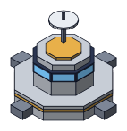

### Command

*Ship kit*

The commander's seat. Sets build and production queues, ship assignments and sale orders. Its central computer reads long-range sensors and guesses whether a contact is a pirate or a freighter.

- **Takes in:** Energy
- **Puts out:** Orders, sensor warnings, ship hold-position calls
- **Power:** 3 MW
- **Run by:** Commander plus bridge crew
- **Look:** Gold band, glass bridge ring, comms dish on a mast

**Decided:** The commander runs things from the arrival ship's bridge at first. The command module comes as a kit from the ship. The ship keeps its own bridge as an emergency refuge.

**Open:** Only one per platform? Do sensor upgrades live here, or in a separate sensor array?

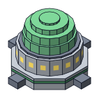

### Habitat

Living quarters for up to 20 humans: sleeping units, bathrooms, kitchens, gardens and entertainment. Gardens grow basic food. Food and entertainment bought from the freighter raise morale.

- **Takes in:** Air, water, energy, bought food and entertainment
- **Puts out:** Rested crew, basic food, morale
- **Power:** 4 MW
- **Run by:** No operators needed
- **Look:** Green band, ring of lit windows, glass garden dome

**Decided:** Not a kit: assembly builds it from mined material. The crew lives aboard the arrival ship at first but needs to move into habitats. More room and relaxation mean higher morale. Habitats are also needed before more humans can join.

**Open:** Does entertainment variety come only from purchases, or can a habitat be upgraded with something like a lounge?

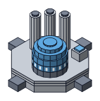

### Electrolysis plant

Melts comet ice into water and splits water into oxygen, with a little hydrogen left over for the fusion generators. Mixes the oxygen with nitrogen to make air. Water and air go out in tanks on the rail train cars to every crewed module's own life support. Oxygen, water and energy running out is what ends the game.

**Decided:** Each one supplies up to 32 humans. Comet ice goes straight from the dock here, not to storage. This is where oxygen and water levels are monitored.

**Open:** How much ice can it hold? When it's full, do comet ships wait at the dock like other ships?

- **Takes in:** Ice straight from docked comet ships, nitrogen from gas storage, energy
- **Puts out:** Tanks of water and air, carried by rail to every crewed module; a little hydrogen
- **Power:** 7 MW
- **Run by:** Human crew
- **Look:** White band, round blue water tank, three tall oxygen cylinders

**Decided:** Not a kit: assembly builds it from mined material. No comet runs until it exists, since ice has nowhere else to go. Until then the crew breathes from the arrival ship's life support, which should be spared for emergencies.

## Resources and energy

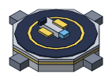

### Ship dock

*Ship kit*

Mining ships land here and unload into storage on their own, then head back out on their standing assignment.

**Decided:** Each dock holds 4 ships. With no free space, returning ships wait in a holding pattern. A ship can't leave the dock until its whole payload is offloaded, so full storage also ties up docking space and you get an alert.

- **Takes in:** Returning ships, energy for refueling, xenon (optional) for faster trips
- **Puts out:** Hydrogen, helium, nitrogen and metals to storage; helium-3 to its own storage; ice to the electrolysis plant; deuterium, argon, neon and methane straight to the modules that use them
- **Power:** 6 MW, mostly for recharging ships
- **Run by:** Human crew; the mining ships fly themselves
- **Look:** Yellow band, dark landing pad with a ring

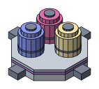

### Gas storage

*From the ship*

One pressurized container each for hydrogen, helium and nitrogen. Other nebula gases skip storage and go straight to the modules that use them. Each container holds its own gas only. You choose gas or metal when you build a new storage module.

- **Takes in:** Hydrogen, helium, nitrogen from docked ships
- **Puts out:** Hydrogen to fusion, nitrogen to the electrolysis plant, gases for sale
- **Power:** 1 MW for its mechanical systems
- **Run by:** No crew needed
- **Look:** Violet band, three round-topped tanks in gas colors

**Decided:** The arrival ship's storage containers detach to become the first gas and metal storage modules, so everything mined early has a place to go. Cheaper to build than metal storage.

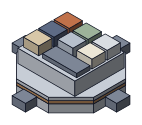

### Metal storage

*From the ship*

One bin for each asteroid metal: iron, nickel, magnesium, silicon, aluminum, platinum and palladium. Each bin holds its own metal only. Costs more to build than gas storage because it holds more material types.

- **Takes in:** Raw metals from docked ships
- **Puts out:** Metals to the refinery, metals for sale
- **Power:** 1 MW for its mechanical systems
- **Run by:** No crew needed
- **Look:** Bronze band, a block topped with seven colored bins

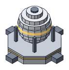

### Helium-3 storage

A single cryogenic sphere that holds helium-3, the rarest and most valuable gas, until a freighter buys it.

- **Takes in:** Helium-3 from docked ships, energy for cooling
- **Puts out:** Helium-3 to the trade port for sale
- **Power:** 2 MW, mostly to keep it cryogenic
- **Run by:** No crew needed
- **Look:** Gold band, frosted white sphere on struts

**Open:** Not in the starting kit? It's the most valuable target on the platform, so do pirates go after it first?

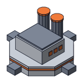

### Refinery

*Ship kit*

Turns raw metals into units of building material. Some metals refine faster than others; aluminum and magnesium are probably quick, and platinum and palladium are slow.

- **Takes in:** Raw metals, argon straight from the dock, energy
- **Puts out:** Building materials, sent to factory, assembly and trade port
- **Power:** 7 MW
- **Run by:** Human crew
- **Look:** Orange band, twin stacks with glowing tops, vents

**Decided:** Refined materials don't go back to storage. They're sent straight to the factory, assembly and trade port modules. Magnesium and aluminum need a little argon per batch; the other metals refine without it. The platform splits refined output by need: factory and assembly first, the trade port gets what is left.

**Open:** If none of them has room, does the refinery pause? Do refined metals sell for more than raw ones?

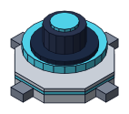

### Fusion generator

*Ship kit*

Burns hydrogen to power the platform, ships and robots. The starting fuel lasts 2,880 hours, about 96 minutes of real time.

- **Takes in:** Hydrogen; deuterium (optional) for a more efficient burn
- **Puts out:** Energy for everything
- **Power:** Makes 60 MW
- **Run by:** No crew needed
- **Look:** Cyan band, dark core inside a glowing ring

**Decided:** The arrival ship carries a fusion generator for the platform, separate from its own engine. Deuterium isn't mined until a fusion generator is running. Its power reaches every module through the frame.

**Decided:** One generator powers a complete set of modules, one of each kind, plus 4 defense junctions, 40 frame pieces with rail and 20 reinforcing junctions, which draw no power.

**Proposed:** A generator makes 60 MW and burns 1 u of hydrogen for every 150 MWh it supplies. Fully loaded, that's about 40 u every 100 hours, roughly what one ship mining only hydrogen brings in. Deuterium makes hydrogen go 25% further. The kit arrives with a sealed fuel core that runs the starter platform for about 2,880 hours.

## Production

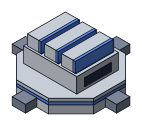

### Factory

*Ship kit*

Turns building materials into parts: frame pieces, fusion generators, module parts, ship parts and robot parts. You set and manage its queue. Parts go straight to assembly.

- **Takes in:** Refined building materials, energy
- **Puts out:** Parts, to assembly
- **Power:** 5 MW
- **Run by:** Human crew
- **Look:** Blue band, sawtooth roof

**Decided:** A separate module, built early alongside the refinery and assembly so the platform can make new modules.

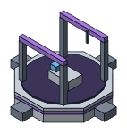

### Assembly

*Ship kit*

Builds ships, robots, weapons and new modules from parts, from a queue you manage. Repairs to damaged structures and robots jump ahead of everything else.

- **Takes in:** Parts from the factory, refined materials, neon and methane straight from the dock, energy
- **Puts out:** Ships, robots, turrets, modules, repairs
- **Power:** 5 MW
- **Run by:** Human crew; construction robots install what it builds
- **Look:** Purple band, open gantry bay

## Trade, structure and defense

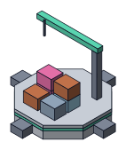

### Trade port

Where the freighter docks. It loads the materials you've set aside for sale and unloads food and entertainment you've bought. It brings new crew you've requested and carries crew to and from vacation. Loan payments go out from here.

- **Takes in:** Raw materials set aside for sale, refined materials from the refinery
- **Puts out:** Credits, supplies, new crew
- **Power:** 3 MW
- **Run by:** Human crew
- **Look:** Mint band, crane boom, stacked cargo crates

**Decided:** A pirate target, after the storage modules.

**Decided:** Freighters need a trade port to dock, so nothing is sold until one is built. It isn't one of the ship kits, so assembly builds it.

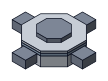

### Reinforcing junction

A small, cheap node that resets the frame's reach. Only a set number of frame pieces can extend from a module or junction before another one is needed. Lets you branch the platform without placing a full module.

- **Takes in:** Nothing to run
- **Puts out:** Structural strength, up to four connections
- **Power:** None
- **Run by:** No one
- **Look:** Half-size octagon, slate band, four ports

**Open:** How many frame pieces before a junction is needed? (Early mockups used 4.)

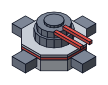

### Defense junction

A reinforcing junction with a phased plasma gun on top. The guns fire on their own and only cover the area around them, so where you place them is what matters. Damaged turrets go to the front of the assembly queue.

- **Takes in:** Energy
- **Puts out:** Protection within its range
- **Power:** 3 MW
- **Run by:** Automated
- **Look:** Red band, low dome, twin barrels

**Decided:** Raids are 1 to 3 pirate ships, aimed mostly at the containers on storage modules, then the trade port and multi-purpose robots. Adequate defense generally holds them off, with some damage.

**Decided:** Each defense junction carries a phased plasma gun that automatically tracks and fires at anything attacking the platform.

**Open:** Is the phased plasma gun the only weapon, or can it be upgraded? Can an existing reinforcing junction be converted into a defense junction?

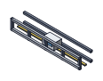

### Frame and rail

Not a module. Fixed-length truss pieces that connect modules and junctions. A train car runs on a rail inside, carrying humans, robots and tanks of water and air between modules. Oxygen and water never flow through the frame itself; with pirate attacks that would be too dangerous.

- **Takes in:** Frame pieces from the factory
- **Puts out:** Connections, crew and tank deliveries, power
- **Power:** 0.1 MW per frame piece, to move the rail cars
- **Run by:** Automated train cars
- **Look:** Open grey truss, yellow rail, white train car

**Decided:** The frame carries power from the fusion generators to every module. If frame damage cuts a module off, it keeps working in a limited way on its battery reserve until power is restored. Damaged rail stops tank deliveries beyond that point until robots repair it.

**Decided:** Rail travel time isn't something to manage. A crewed module is fine as long as it gets a delivery of water and air once per day, and that stays manageable as the platform grows.
